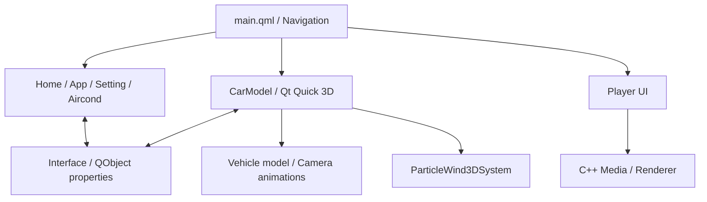

# DonutCarMonitor

**日本語** | [简体中文](README.zh-CN.md)

**Qt Quick / QMLとQt Quick 3Dを使った、車載HMIと3D車両ビューアーのデモアプリケーションです。**

ホーム、アプリ一覧、設定、空調操作などの画面と、車両モデルを操作できる3Dビューを一つのアプリケーションにまとめています。2D UI、3Dアニメーション、パーティクル表現、C++による状態管理の連携に取り組んだ個人開発プロジェクトです。

BilibiliのDennis-X氏によるチュートリアルを参考に、車載風UIと3Dモデルの閲覧・操作を組み合わせています。


## 主な機能

| 分類 | 内容 |
|---|---|
| HMI | ホーム、アプリ一覧、設定、空調操作、コントロールセンターの画面 |
| 3Dモデル操作 | 車両の外観・車内表示、ドアとトランクの開閉、車体色の変更 |
| カメラ操作 | 車外・車内・空調付近への視点切り替えとアニメーション |
| 空調表現 | 左右の温度・風量操作、吹き出し方向の変更、2D／3Dパーティクルによる風の可視化 |
| 状態連携 | C++の`QObject`プロパティと変更通知によるQMLとの連携 |
| メディア画面 | C++の再生処理とQMLプレーヤー画面を組み込む構成 |

本プロジェクトの車両情報や空調操作はUI上のデモです。実車のECU、CAN通信、空調機器への接続は対象に含めていません。

## 3D表示とインタラクション

### 車両モデルと視点切り替え

車両の外観と車内を表示し、ドアやトランクの開閉を操作できます。カメラの位置や向きをアニメーションさせ、外観・車内・空調付近の視点を切り替えます。


### 空調の可視化

風向や風量を数値だけで示すのではなく、パーティクルの向き、放出量、色などに反映する構成です。3Dの吹き出し口と操作UIをつなぎ、操作結果を視覚的に確認できるようにしています。


## 設計・実装で取り組んだこと

### 1. 画面と共通状態の分離

画面遷移、空調の風量・左右の温度、コントロールセンターの状態などを、C++の`Interface`クラスで管理しています。`Q_PROPERTY`と変更通知を通じてQMLへ公開し、複数の画面から共通の状態を参照・変更する構成です。

### 2. QMLコンポーネントの再利用

ナビゲーション、ステータスバー、スライダー、スイッチ、温度選択などを個別のコンポーネントに分けています。各ページはこれらを組み合わせて構成し、共通の操作部品とページ固有の処理を分離しています。

### 3. 2D UIと3Dシーンの連動

ボタンやスライダーの値を3Dモデルの回転、カメラ、パーティクルのパラメーターへ接続しています。特に、ドアの開閉、視点の移動、空調の風向調整を通じて、入力とアニメーションの関係を扱っています。

### 4. メディア機能の組み込み

`src/media/`にC++の音声・映像処理、`src/playerUI/`にQMLの操作画面を配置しています。車載風の画面構成の中に、別の機能モジュールとしてプレーヤーを組み込む構成です。

## 構成



## ソースコードの見どころ

| ファイル／ディレクトリー | 役割 |
|---|---|
| [src/main.qml](src/main.qml) | ページの読み込み、ナビゲーション、コントロールセンター |
| [src/interface.h](src/interface.h) / [src/interface.cpp](src/interface.cpp) | C++側の共通状態とQMLへの公開 |
| [src/hmi/CarModel.qml](src/hmi/CarModel.qml) | 車両モデル、ドア操作、カメラ、空調の3D表現 |
| [src/hmi/Aircond.qml](src/hmi/Aircond.qml) | 空調操作画面と2Dの風表現 |
| [src/components/ParticleWind3DSystem.qml](src/components/ParticleWind3DSystem.qml) | 3Dパーティクルと風向・風量パラメーター |
| [src/components/](src/components/) | 再利用するUIコンポーネント |
| [src/media/](src/media/) / [src/playerUI/](src/playerUI/) | メディア処理とプレーヤー画面 |

UIとC++の連携は`Interface`、3Dインタラクションは`CarModel.qml`から確認できます。

## 使用技術

| 技術 | 用途 |
|---|---|
| C++17 | 共通状態の管理、メディア処理 |
| Qt 6.6以上 / Qt Quick / QML | 画面、入力、アニメーション |
| Qt Quick 3D / Helpers / Effects / Particles | 車両モデル、カメラ、描画効果、3Dパーティクル |
| FFmpeg / SDL2 / SoundTouch | プレーヤー部分のメディア処理と音声出力 |
| OpenGL / GLM / stb_image / spdlog | メディア描画、行列、画像読み込み、ログ |
| CMake 3.22以上 | ビルド設定 |

## ビルドと実行

WindowsのMSVC／MinGW向けに構成しています。付属のバッチファイルではQt 6.6.3のMSVC用キットを指定しています。

### 事前準備

現在のリポジトリーは主にソースコードを収録しています。ビルドには、[CMakeLists.txt](CMakeLists.txt)と`src/*.qrc`に記載された依存ファイル・モデル・画像などを別途配置する必要があります。

- Qt Quick 3D関連モジュールを含むQtキット。
- `include/`と`lib/`から参照するFFmpeg、SDL2、SoundTouch、GLM、stb_image、spdlog等。
- QRCで参照するメッシュ、テクスチャー、画像、フォント等のリソース。
- 実行時に必要なQtプラグイン、外部ライブラリーのDLL、メディア描画用リソース。

### MSVCでのコマンド例

依存ファイルを用意し、Qtキットのパスを使用環境に合わせて変更したうえで実行します。以下はPowerShellの例です。

```powershell
cmake -S . -B build -DCMAKE_PREFIX_PATH="C:/Qt/6.6.3/msvc2019_64"
cmake --build build --config Release
& "C:/Qt/6.6.3/msvc2019_64/bin/windeployqt.exe" "./bin/msvc/DonutCarMonitor.exe" --qmldir "./src"
```

MSVCの実行ファイルは`bin/msvc/`、MinGWでは`bin/mingw/`へ出力する設定です。Qt以外のDLLは別途配置します。相対パスで読み込むリソースに合わせて、作業ディレクトリーも設定してください。現在のVisual Studio用デバッグ設定は`bin/`を指定しています。

既存の`build.bat`／`install.bat`を使う場合も、Qtのインストール先とキットを変更してください。MinGWの場合はQt Creatorで対応するキットを選択します。

## プロジェクトを通じて扱ったテーマ

- 操作画面とC++の状態管理をつなぐインターフェース設計。
- 2D UIと3Dシーンを組み合わせたインタラクション。
- アニメーション、カメラ、パーティクルによる状態の可視化。
- 共通UI部品と機能モジュールの整理。

## その他の画面例


## 参考・クレジット

車載風UIの学習には、BilibiliのDennis-X氏によるチュートリアルを参考にしました。3Dモデルや画像などの素材と、UI・制御コードの実装は区別して扱っています。

本リポジトリーは、HMIとグラフィックスの実装を学ぶための個人プロジェクトです。
