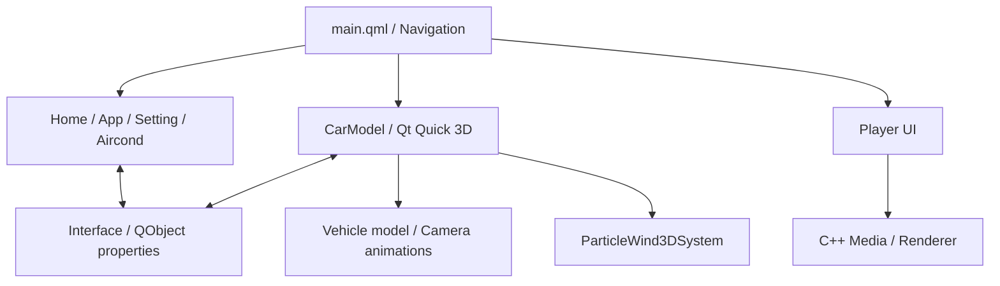

# DonutCarMonitor

[日本語](README.md) | **简体中文**

**使用 Qt Quick / QML 和 Qt Quick 3D 构建的车载 HMI 与 3D 车辆浏览演示程序。**

将主页、应用列表、设置、空调控制等页面与可交互的 3D 车辆视图整合到同一应用中。作为个人开发项目，重点实践了 2D UI、3D 动画、粒子表现与 C++ 状态管理之间的连接。

项目参考 Bilibili 的 Dennis-X 教程，结合车机风格界面与 3D 模型浏览、交互功能。


## 主要功能

| 分类 | 内容 |
|---|---|
| HMI | 主页、应用列表、设置、空调控制与控制中心页面 |
| 3D 模型交互 | 车辆外观与车内显示、车门和后备箱开闭、车身颜色修改 |
| 相机操作 | 车外、车内及空调附近的视角切换与动画 |
| 空调表现 | 左右温度与风量操作、出风方向调整、通过 2D／3D 粒子显示气流 |
| 状态交互 | 通过 C++ `QObject` 属性与变更通知连接 QML |
| 媒体页面 | 接入 C++ 播放流程与 QML 播放器界面 |

本项目中的车辆信息和空调操作属于 UI 演示，未接入实车 ECU、CAN 通信或空调硬件。

## 3D 显示与交互

### 车辆模型与视角切换

支持显示车辆外观和车内视图，并操作车门、后备箱的开闭。通过相机位置与朝向动画，切换外观、车内和空调附近的视角。


### 空调可视化

风向和风量除了用数值表示，也会反映到粒子的方向、发射量和颜色等参数中。将 3D 出风口与操作 UI 连接，使操作结果可以直观地显示出来。


## 设计与实现

### 1. 分离页面与共享状态

使用 C++ 的 `Interface` 类管理页面切换、空调风量、左右温度和控制中心等状态。通过 `Q_PROPERTY` 与变更通知向 QML 暴露数据，让多个页面能够读取和修改同一份状态。

### 2. 复用 QML 组件

将导航、状态栏、滑块、开关和温度选择等拆分为独立组件。各页面通过组合组件构建，分离共用操作控件与页面专属逻辑。

### 3. 连接 2D UI 与 3D 场景

将按钮和滑块的值连接到 3D 模型旋转、相机及粒子参数。通过车门开闭、视角移动和空调风向调整，实践输入与动画之间的关系。

### 4. 接入媒体功能

`src/media/` 包含 C++ 音视频处理，`src/playerUI/` 包含 QML 播放操作界面。播放器以独立功能模块接入车机风格的页面结构。

## 整体结构



## 源码阅读入口

| 文件／目录 | 职责 |
|---|---|
| [src/main.qml](src/main.qml) | 页面加载、导航与控制中心 |
| [src/interface.h](src/interface.h) / [src/interface.cpp](src/interface.cpp) | C++ 共享状态及向 QML 暴露的接口 |
| [src/hmi/CarModel.qml](src/hmi/CarModel.qml) | 车辆模型、车门操作、相机及空调的 3D 表现 |
| [src/hmi/Aircond.qml](src/hmi/Aircond.qml) | 空调操作界面与 2D 气流表现 |
| [src/components/ParticleWind3DSystem.qml](src/components/ParticleWind3DSystem.qml) | 3D 粒子与风向、风量参数 |
| [src/components/](src/components/) | 可复用的 UI 组件 |
| [src/media/](src/media/) / [src/playerUI/](src/playerUI/) | 媒体处理与播放器界面 |

UI 与 C++ 的连接可以从 `Interface` 开始阅读，3D 交互可以从 `CarModel.qml` 开始阅读。

## 技术栈

| 技术 | 用途 |
|---|---|
| C++17 | 共享状态管理、媒体处理 |
| Qt 6.6 及以上 / Qt Quick / QML | 界面、输入、动画 |
| Qt Quick 3D / Helpers / Effects / Particles | 车辆模型、相机、渲染效果、3D 粒子 |
| FFmpeg / SDL2 / SoundTouch | 播放器的媒体处理与音频输出 |
| OpenGL / GLM / stb_image / spdlog | 媒体渲染、矩阵、图片读取与日志 |
| CMake 3.22 及以上 | 构建配置 |

## 构建与运行

项目面向 Windows 下的 MSVC／MinGW。仓库中的批处理文件指定了 Qt 6.6.3 的 MSVC Kit。

### 准备依赖

当前仓库主要包含源码。构建前需要补齐 [CMakeLists.txt](CMakeLists.txt) 和 `src/*.qrc` 中引用的依赖文件、模型和图片等内容。

- 包含 Qt Quick 3D 相关模块的 Qt Kit。
- `include/` 和 `lib/` 引用的 FFmpeg、SDL2、SoundTouch、GLM、stb_image、spdlog 等。
- QRC 引用的网格、纹理、图片、字体等资源。
- 运行时所需的 Qt 插件、外部库 DLL 和媒体渲染资源。

### MSVC 命令示例

准备好依赖后，将 Qt Kit 路径修改为本机路径。以下命令在 PowerShell 中执行。

```powershell
cmake -S . -B build -DCMAKE_PREFIX_PATH="C:/Qt/6.6.3/msvc2019_64"
cmake --build build --config Release
& "C:/Qt/6.6.3/msvc2019_64/bin/windeployqt.exe" "./bin/msvc/DonutCarMonitor.exe" --qmldir "./src"
```

MSVC 的可执行文件输出到 `bin/msvc/`，MinGW 输出到 `bin/mingw/`。Qt 之外的 DLL 需要另行放置。请根据资源的相对路径设置工作目录；当前 Visual Studio 调试配置指定的工作目录为 `bin/`。

使用现有 `build.bat`／`install.bat` 时，也需要修改 Qt 安装路径和 Kit。MinGW 构建使用 Qt Creator 并选择对应 Kit。

## 项目中的实践主题

- 连接操作界面与 C++ 状态管理的接口设计。
- 结合 2D UI 与 3D 场景的交互。
- 通过动画、相机和粒子实现状态可视化。
- 整理共用 UI 组件与功能模块。

## 更多界面


## 参考与致谢

车机风格 UI 的学习参考了 Bilibili 的 Dennis-X 教程。3D 模型、图片等素材与 UI、控制代码的实现分别看待。

本仓库是用于学习 HMI 与图形界面实现的个人项目。
